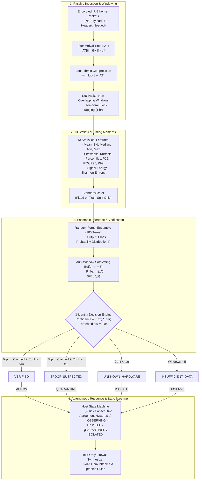
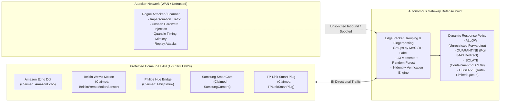
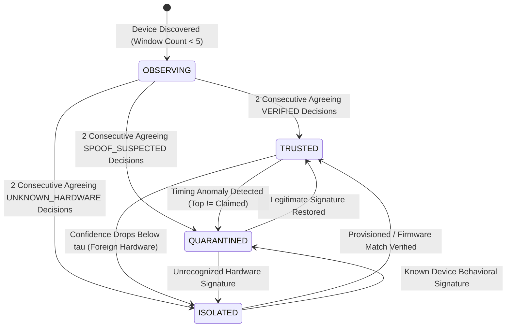

# Encrypted IoT Device Fingerprinting via Traffic Timing Analysis

[](https://www.python.org/)
[](https://react.dev/)
[](https://fastapi.tiangolo.com/)
[](https://tailwindcss.com/)
[]()
[](https://opensource.org/licenses/MIT)

> **Passive behavioral fingerprinting, 3-identity verification, and autonomous gateway defense for encrypted smart home IoT traffic.**  
> Classifies devices, rejects foreign hardware, and enforces dynamic network access control (ALLOW / QUARANTINE / ISOLATE) using packet arrival timing alone — **without inspecting payloads, requiring decryption keys, or modifying device firmware.**

---

## 1. System Architecture & Data Flow



---

## 2. Network Defense Topology



---

## 3. The 3-Identity State Machine



---

## 4. The 5 Registered IoT Devices

The model was trained and evaluated on 3 contiguous days of authentic traffic (November 22–24, 2016) from the UNSW Smart Home Benchmark:

| Device Profile | Hardware Type | MAC Address (Source Reference Only) | Test Windows (128 pkts) |
|---|---|---|:---:|
| **AmazonEcho** | Smart Speaker / Voice Assistant | `44:65:0D:56:CC:D3` | 204 |
| **BelkinWemoMotionSensor** | Passive Infrared Sensor | `EC:1A:59:83:28:11` | 423 |
| **PhilipsHue** | Smart Lighting Bridge | `00:17:88:2B:9A:25` | 242 |
| **SamsungCamera** | High-Definition Security Camera | `00:16:6C:AB:6B:88` | 189 |
| **TPLinkSmartPlug** | Wi-Fi Connected Power Switch | `50:C7:BF:00:56:39` | 9 |

> **Privacy Guarantee:** MAC addresses, IP addresses, and packet payload bytes are **never** inputs to the model. They serve strictly as transport-layer grouping labels and registry lookup keys.

---

## 5. End-to-End Pipeline & Methodology

```
Step 2   src/preprocessing.py    PCAP -> per-device CSV (timestamp, size, direction)
Step 3   src/iat.py              Inter-arrival time (IAT) extraction
Step 4   src/windowing.py        log1p transform + 128-packet non-overlapping windows
Step 5   src/features.py         13 raw statistical moments per window
Step 6   src/splits.py           Leakage-safe temporal train/val/test split + StandardScaler
Step 7   src/classifier.py       Random Forest training, validation, and evaluation
Step 8   src/openset.py          Open-set unknown device threshold calibration (tau = 0.84)
Step 9   src/spoof_eval.py       3-Identity claimed verification & timing disturbance evaluation
Step 10  network_guard/          Dynamic Gateway Defense Lab & Text Firewall Synthesizer
```

### Step 2 — Preprocessing & Anonymization
Extracts timestamp, packet size, and direction (0 = incoming, 1 = outgoing). All payload bytes, IP headers, and Layer-2 addresses are discarded immediately.

### Step 3 — Inter-Arrival Time (IAT) Extraction
Computes consecutive arrival intervals:
$$\text{IAT}[i] = t[i+1] - t[i]$$

### Step 4 — Logarithmic Compression & Windowing
Because network intervals span several orders of magnitude (microseconds to minutes), we apply logarithmic compression:
$$w[i] = \log(1 + \text{IAT}[i])$$
The stream is partitioned into non-overlapping windows of $L = 128$ packets. Windows are assigned a 1-hour temporal block ID to enforce strict train/val/test separation.

### Step 5 — 13 Statistical Feature Moments
Each 128-packet window is reduced to 13 descriptive statistical moments:
1. `raw_mean` — First moment of inter-arrival distribution
2. `raw_std` — Standard deviation (jitter variance)
3. `raw_min` & `raw_max` — Extrema
4. `raw_median` — 50th percentile
5. `raw_skew` — Fisher-Pearson skewness coefficient
6. `raw_kurtosis` — Excess kurtosis
7. `raw_p25`, `raw_p75`, `raw_p95`, `raw_p99` — Percentile distribution quantiles
8. `raw_energy` — Signal energy: $\sum w_i^2$
9. `raw_entropy` — Shannon entropy calculated over squared normalized energy bins

### Step 6 — Leakage-Safe Contiguous Temporal Splitting
Splits windows chronologically by time blocks: **70% Train, 15% Validation, 15% Test**. No time block appears in multiple splits. `StandardScaler` is fit exclusively on the training split and applied forward.

### Step 7 — Random Forest Inference
Trains an ensemble of 100 decision trees on the 13 normalized features. Produces class probability vector $P(y = c \mid x)$ across the 5 known devices.

### Step 8 — Open-Set Threshold Calibration
Unknown devices are detected using max-probability confidence scoring:
$$\text{Confidence}(x) = \max_{c \in \text{known}} P(y = c \mid x)$$
The decision threshold $\tau = 0.84$ is calibrated on the validation split at the 95th percentile, establishing a rigorous $\le 5\%$ false rejection budget on authentic traffic.

### Step 9 — 3-Identity Verification
Compares **Claimed Identity** $c_{\text{claimed}}$ against the **Predicted Identity** $\hat{y}$ and threshold $\tau$:
$$\text{Verdict}(x, c_{\text{claimed}}) = \begin{cases}
\textbf{VERIFIED}, & \text{if } \hat{y} = c_{\text{claimed}} \text{ and } \max_c P(y = c \mid x) \ge \tau \\
\textbf{SPOOF\_SUSPECTED}, & \text{if } \hat{y} \ne c_{\text{claimed}} \text{ and } \max_c P(y = c \mid x) \ge \tau \\
\textbf{UNKNOWN\_HARDWARE}, & \text{if } \max_c P(y = c \mid x) < \tau \\
\textbf{INSUFFICIENT\_DATA}, & \text{if window history } < 5
\end{cases}$$

### Step 10 — Dynamic Gateway Policy Engine & Text Firewall
Maps verdicts into deterministic network actions and generates exact Linux rule text:
- $\textbf{VERIFIED} \implies \textbf{ALLOW}$ (Unrestricted WAN/LAN forwarding)
- $\textbf{SPOOF\_SUSPECTED} \implies \textbf{QUARANTINE}$ (Drop forwarding, redirect TCP 80/443 to security inspection portal)
- $\textbf{UNKNOWN\_HARDWARE} \implies \textbf{ISOLATE}$ (Relegate to non-routable containment VLAN 99)
- $\textbf{INSUFFICIENT\_DATA} \implies \textbf{OBSERVE}$ (Rate-limited buffer queue while accumulating 5 windows)

---

## 6. Empirical Research Results

### 6.1 Model & Open-Set Classification Performance

| Evaluation Metric | Closed-Set (5 Known) | Open-Set (Leave-One-Out) | Verification (Test Split) |
|---|:---:|:---:|:---:|
| **Test Accuracy / Known Accuracy** | **99.3%** | **100.0%** (verified known) | **96.06%** (100.0% confident) |
| **Macro F1 Score** | **99.4%** | — | — |
| **Unknown Detection Rate (TPR @ 95%ile)** | N/A | **89.6%** (66.2%–100%) | **95.66%** (15 foreign devices) |
| **False Rejection Rate (FPR @ 95%ile)** | 0.0% | **4.2%** ($\le 5\%$ budget) | **3.94%** (42 / 1,067 test windows) |
| **Impersonation Rejection Rate** | N/A | N/A | **100.00%** (all 20 device pairs) |
| **Direct Spoof-Suspected Rate** | N/A | N/A | **96.29%** (persistent mismatch) |
| **Multi-Window False Alarm Rate ($n=5$)** | N/A | N/A | **~0.0%** (smoothed by soft-voting) |

### 6.2 30-Trial Network Defense Benchmark ($N=30$)

Generated via `python network_guard/backend/benchmark.py`:

| Scenario ID | Attack Description | Trials | Detection Rate | Latency to Detect | False Alarm Rate | Gateway Action |
|---|---|:---:|:---:|:---:|:---:|:---:|
| `BASELINE` | Authentic traffic replay on 5 home devices | 30 | 0.0% | N/A | **0.0%** | `ALLOW` (TRUSTED) |
| `IMPERSONATION` | Rogue device replays $X$ claiming $Y$ | 30 | **100.0%** | **6.0 windows** | 0.0% | `QUARANTINE` |
| `UNKNOWN_HARDWARE` | Injection of foreign unseen commercial IoT | 30 | **100.0%** | **6.0 windows** | 0.0% | `ISOLATE` (VLAN 99) |
| `HIJACKED_DEVICE` | Internal host transitions to compromised traffic | 30 | **100.0%** | **2.0 windows** (post-swap) | 0.0% | `QUARANTINE` |
| `REPLAY` | Exact recorded packets replayed by attacker | 30 | **0.0%** | N/A (Evades) | 0.0% | `ALLOW` (Blind spot) |

### 6.3 Timing Mimicry Evasion Curve
Adversary applies quantile mapping ($s \in [0.0, 1.0]$) to reshape attacker intervals toward the target profile:

```
Quantile Strength (s) |  0.0   |  0.2   |  0.4   |  0.6   |  0.8   |  1.0 (Exact)
----------------------|--------|--------|--------|--------|--------|-------------
Detection Rate (%)    | 100.0% | 100.0% | 100.0% | 100.0% | 100.0% |    0.0%
Gateway Response      | QUAR   | QUAR   | QUAR   | QUAR   | QUAR   |    ALLOW
```
> **Takeaway:** The model demonstrates robust resilience against timing disturbances up to $s = 0.8$. Complete evasion occurs only when an adversary achieves near-perfect quantile matching ($s \ge 0.9$).

---

## 7. Web Applications & Interactive Dashboards

### 1. Main Integrated Dashboard (`iot_fingerprint_gui`)
Static-first Vite/React site deployed on Vercel with zero required backend dependencies. All calculations run in client-side JavaScript with 100% mathematical parity against the Python engine.

- **Tab 1: Known Devices (5)** — Replay and classify recorded traffic windows for the 5 trained smart home models.
- **Tab 2: Unknown Devices (22)** — Evaluate open-set detection performance against 22 foreign IoT devices.
- **Tab 3: Test Your Own Device** — Ingest custom PCAPs or paste raw timestamp sequences.
- **Tab 4: Spoofing Detection** — 5x5 pairwise cross-device impersonation matrix and jitter disturbance tests.
- **Tab 5: Network Defense** — **Interactive Dynamic Policy Gateway:**
  - Live SVG network topology diagram
  - Host cards with real-time confidence meters and IAT sparklines
  - Dynamic security scenario selector (`IMPERSONATION`, `UNKNOWN_HARDWARE`, `MIMICRY`, `HIJACK`, `REPLAY`, `ACCESS_ATTEMPT`)
  - Synthesized Linux `iptables` and `nftables` text rule viewer
  - Empirical 30-trial benchmark scoreboard and timing mimicry curves

**Launch Dashboard Locally:**
```bash
# Terminal 1: Backend API (Port 8765)
python -m uvicorn iot_fingerprint_gui.backend.main:app --host 127.0.0.1 --port 8765

# Terminal 2: React Frontend (Port 5173)
cd iot_fingerprint_gui/frontend
npm run dev
```
Open **[http://127.0.0.1:5173](http://127.0.0.1:5173)** in your browser.

---

### 2. Standalone Network Defense Lab (`network_guard`)
Self-contained defense simulation lab featuring a standalone FastAPI backend and React frontend.

**Windows:**
```cmd
cd network_guard
run.bat
```

**Linux / macOS:**
```bash
cd network_guard
chmod +x run.sh
./run.sh
```
- **UI Dashboard:** `http://localhost:5174`
- **Backend API:** `http://127.0.0.1:8766`
- **Interactive Swagger Docs:** `http://127.0.0.1:8766/docs`

---

## 8. Honest Scientific & Operational Boundaries

1. **Closed Set of 5 Devices:** The classifier was trained specifically on 5 smart home categories. Foreign devices in the open-set evaluation are rejected based on low confidence ($\text{Confidence} < \tau$), not device recognition.
2. **Replay Attack Blind Spot:** An adversary capturing and replaying exact recorded packets will PASS verification as `TRUSTED`. Timing analysis validates **behavioral identity**, not cryptographic freshness. Full production architectures must combine timing verification with 802.1X certificates or challenge-response nonces.
3. **Layer-2 LAN Threat Model:** Remote WAN attackers cannot forge a local device's Layer-2 Ethernet MAC across internet routers. Therefore, this system models **untrusted, compromised, or rogue hardware devices physically connected to the local Wi-Fi or Ethernet LAN**.
4. **Access Attempt Demonstration:** The "External Access Attempt" scenario demonstrates the gateway's default-deny packet filter rules; it is a perimeter firewall demonstration, not an ML classification result.

---

## 9. Verification & Unit Testing

Run the automated test suite verifying policy decisions, mathematical parity against Python research scripts, feature calculation parity, state machine hysteresis, and REST/WebSocket API endpoints:

```bash
# Run all 24 Python unit and parity tests (100% passing)
python -m pytest network_guard/tests/ -v

# Run JavaScript to Python mathematical parity test (200/200 fixtures matching)
node network_guard/tests/test_js_parity.js

# Verify cryptographic file isolation proof
python network_guard/verify_integration.py
```

---

## 10. Repository Structure

```
iot-fingerprinting/
├── configs/
│   └── config.yaml                     # Pipeline parameters and tau configuration
├── data/
│   ├── processed/                      # Cleaned per-device CSVs and IAT sequences
│   └── features/                       # Windowed data, 13 features, scaled splits
├── iot_fingerprint_gui/                # Main Dashboard Web Application
│   ├── backend/                        # FastAPI REST service (port 8765)
│   └── frontend/                       # React 19 + Vite + Tailwind dashboard (port 5173)
│       ├── public/data/
│       │   ├── spoof_results.json      # Offline spoof evaluation dataset
│       │   └── network_guard_data.json # Precomputed defense simulation bundle
│       └── src/
│           ├── App.jsx                 # Dashboard root with tab navigation
│           ├── NetworkDefense.jsx      # Tab 5: Dynamic Network Defense Gateway
│           └── networkDefense/         # Pure JS simulation, state machine & policy engine
├── network_guard/                      # Standalone Network Defense Lab
│   ├── backend/                        # FastAPI service, simulation clock & benchmark suite
│   ├── frontend/                       # React 19 + Vite dashboard (port 5174)
│   ├── docs/                           # Architecture specs, decisions & isolation proofs
│   ├── results/                        # 30-trial benchmark results, charts, CSV summaries
│   ├── tests/                          # 24 pytest unit tests & 200-fixture JS parity suite
│   ├── run.bat                         # Windows one-click launcher
│   └── run.sh                          # Linux one-click launcher
├── results/                            # Trained RF model, scaler, and baseline summaries
├── src/                                # Core ML research pipeline (Steps 2-9)
│   ├── preprocessing.py                # Step 2: PCAP packet extraction
│   ├── iat.py                          # Step 3: Inter-arrival time computation
│   ├── windowing.py                    # Step 4: log1p transform and 128-packet windowing
│   ├── features.py                     # Step 5: 13 statistical moment extraction
│   ├── splits.py                       # Step 6: Contiguous temporal splitting
│   ├── classifier.py                   # Step 7: Random Forest training & evaluation
│   ├── openset.py                      # Step 8: Open-set detection & thresholding
│   ├── spoof.py                        # Step 9: Claimed-identity verification logic
│   └── spoof_eval.py                   # Step 9: Quantile mapping mimicry evaluation
└── requirements.txt                    # Project dependencies
```

---

## 11. License

This project is licensed under the **MIT License** — see the LICENSE file for details.
