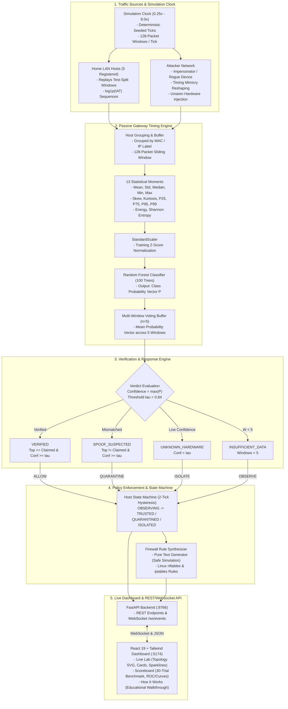

# Network Defense Lab — System Architecture

The **Network Defense Lab** is an autonomous, passive security simulation environment for the research project *"Encrypted IoT Device Fingerprinting via Traffic Timing Analysis"*. It demonstrates how gateway-level passive traffic timing observation, combined with a 13-feature Random Forest model and a 3-identity verification policy engine, dynamically enforces access control (ALLOW / QUARANTINE / ISOLATE) without decrypting payloads or installing agents on endpoints.

---

## 1. High-Level Architecture Diagram

---

## 2. Component Breakdown

### 2.1 Backend Core (`network_guard/backend/`)
- **`config.py`**: Centralized configuration management. Sets server port (`8766`), Vite port (`5174`), paths to read-only project models and dataset features, default threshold $\tau = 0.84$, and suppression of scikit-learn multithreading warnings for seamless simulation execution.
- **`model_loader.py`**: Model manager handling loading of `rf_model.pkl` (100-tree Random Forest), `raw_stat_scaler.pkl` (fitted StandardScaler dictionary wrapped via `src.spoof.ScalerWrapper`), authentic test-split windows (`raw_scaled_test.csv`), and 15 unseen foreign devices (`unknown_devices_windows.csv`). Strict zero data leakage: only test-split rows are utilized for evaluation and simulation replaying.
- **`policy.py`**: Pure, deterministic policy engine implementing the 3-identity mathematical formulation:
  $$\text{Confidence} = \max_c P(c)$$
  $$\text{Top Class} = \arg\max_c P(c)$$
  - If $\text{Window Count} < 5$: `INSUFFICIENT_DATA` $\to$ `OBSERVE`
  - Else If $\text{Confidence} < \tau$: `UNKNOWN_HARDWARE` $\to$ `ISOLATE`
  - Else If $\text{Top Class} == \text{Claimed Class}$: `VERIFIED` $\to$ `ALLOW`
  - Else: `SPOOF_SUSPECTED` $\to$ `QUARANTINE`
- **`state_machine.py`**: Per-host state machine with configurable hysteresis. Maintains a 5-window probability aggregation history and requires 2 consecutive matching device verdicts before transitioning a host from `OBSERVING` to `TRUSTED`, `QUARANTINED`, or `ISOLATED`.
- **`firewall.py`**: Safe, text-only firewall rule generator. Produces exact, production-ready `nftables` and `iptables` rule strings for each state transition (e.g. redirecting quarantined hosts to captive inspection, isolating unknown hardware to non-routable VLAN 99, or dropping unsolicited external WAN access attempts). No OS sockets or packet filters are ever modified.
- **`simulation.py`**: Simulation orchestrator managing virtual clock ticks, host traffic streams, scenario lifecycle, live IAT sparklines, and WebSocket broadcast events. Supports 6 scenarios:
  1. `BASELINE`: All 5 legitimate hosts replay authentic test traffic.
  2. `IMPERSONATION`: Rogue attacker replays known device traffic while claiming another device's identity.
  3. `UNKNOWN_HARDWARE`: Attacker injects traffic from an unseen IoT device (e.g. Withings Scale).
  4. `TIMING_MIMICRY`: Attacker applies quantile mapping ($s \in [0, 1]$) and log-domain Gaussian jitter toward target profile.
  5. `HIJACKED_DEVICE`: Legitimate host transitions into compromised behavior at tick $T_h$.
  6. `REPLAY`: Attacker replays target's exact recorded test traffic (demonstrates passive timing verification blind spot).
  7. `ACCESS_ATTEMPT`: Attacker attempts direct WAN network probing against internal hosts; demonstrates gateway default-deny firewall defense.
- **`benchmark.py`**: Batch statistical evaluator executing $N=30$ seeded trials across scenarios, recording detection rates, mean/median windows to detect, false alarm rates, and generating publication-grade plots and CSV summaries.
- **`main.py`**: FastAPI application exposing REST management endpoints and real-time WebSocket tick stream `/ws/events`.

### 2.2 Frontend Application (`network_guard/frontend/`)
- Built with **React 19**, **Vite**, **Tailwind CSS**, and **Lucide Icons**.
- **Live Lab Tab**:
  - Interactive SVG topology diagram illustrating the Attacker Network, Gateway Defense Point, and Home IoT LAN.
  - Live Host Cards displaying real-time state badge, predicted class, confidence meter, class probability breakdown, and live 10-point IAT sparklines.
  - Control Drawer for scenario selection, parameter tuning, speed slider ($0.25\times - 8.0\times$), and real-time $\tau$ threshold adjustment.
  - Live Firewall Inspector rendering syntactically valid `iptables` and `nftables` rules for dynamic access transitions.
- **Scoreboard Tab**:
  - Benchmark performance metrics derived from real 30-trial batch evaluation.
  - Interactive charts illustrating detection rate vs. attack type, windows-to-detect latency, and the timing mimicry evasion curve.
  - One-click benchmark trigger with real-time progress indicator and CSV/JSON export.
- **How It Works Tab**:
  - Visual 4-stage pipeline explanation (Ingestion $\to$ Moments $\to$ Random Forest $\to$ 3-Identity Verdict).
  - Verdict & Policy decision matrix.
  - Transparent "Honest Scientific Limits" section explicitly documenting the closed 5-device universe, replay blind spots, mimicry thresholds, and Layer-2 vs. Layer-3 LAN threat models.

---

## 3. Communication Protocols

| Channel | Endpoint | Protocol | Description |
|---|---|---|---|
| Health Check | `GET /health` | HTTP JSON | Returns engine state, tau, simulation status |
| Model Info | `GET /model/info` | HTTP JSON | Returns model classes, features, and available unseen devices |
| Topology | `GET /topology` | HTTP JSON | Network nodes and links for SVG rendering |
| Host States | `GET /hosts` | HTTP JSON | Current state, probabilities, and verdicts for all hosts |
| Sim Control | `POST /sim/start` | HTTP JSON | Launches chosen scenario with parameters |
| Sim Speed | `POST /sim/speed` | HTTP JSON | Dynamically adjusts tick frequency (0.25x - 8.0x) |
| Sim Reset | `POST /sim/reset` | HTTP JSON | Clears state machine and restores baseline observing |
| Tau Tuning | `POST /config/tau` | HTTP JSON | Updates active confidence threshold in memory |
| Live Stream | `WS /ws/events` | WebSocket JSON | Pushes tick events, per-host verdicts, and firewall rules |
| Benchmark | `POST /benchmark/run` | HTTP JSON | Executes N-trial batch statistical suite |
| Full Report | `GET /report` | HTTP JSON | Aggregated system status, metrics, and logs |
