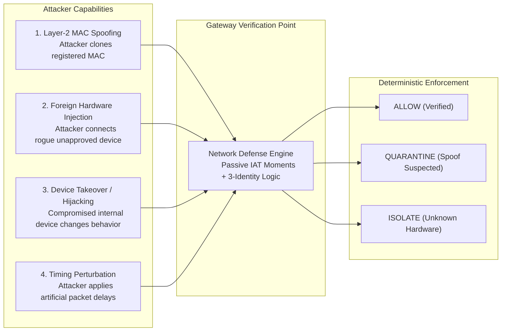
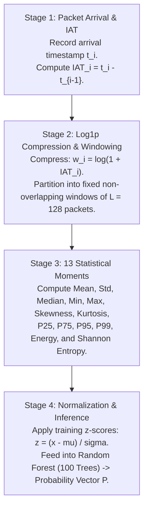
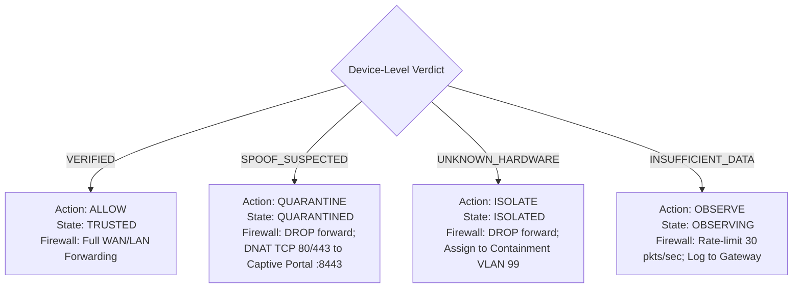

# Comprehensive Study & Defense Guide: The Network Defense Lab

**Project:** Encrypted IoT Device Fingerprinting via Traffic Timing Analysis  
**Module:** Network Defense Lab & Dynamic Policy Gateway (Tab 5)  
**Target Audience:** Project Reviewers, Viva Examiners, and Engineers  
**Date:** October 2026  

---

## 1. Executive Summary & Core Motivation

### The Problem
Smart home IoT devices (smart plugs, IP cameras, voice assistants, sensor bridges) increasingly transmit data over **end-to-end encrypted protocols** (TLS 1.3, DTLS, proprietary clouds). Traditional Intrusion Detection Systems (NIDS) rely on:
1. **Deep Packet Inspection (DPI):** Obsoleted by modern transport encryption.
2. **MAC / IP Filtering:** Trivial to forge; any attacker on the local Wi-Fi or Ethernet network can change their Layer-2 MAC address with a single command (`macchanger`).
3. **Hardware Tokens / 802.1X Agents:** Impractical on inexpensive, constrained microcontrollers ($2–$5 devices with limited compute and memory).

### The Solution: Passive Behavioral Fingerprinting
Instead of inspecting packet contents or trusting spoofable headers, the **Network Defense Lab** fingerprints devices based on **how they communicate in the time domain**:
- Hardware architecture, firmware loops, network chip buffers, and physical clock crystal oscillators create subtle, distinct **inter-arrival timing (IAT) patterns**.
- A passive gateway monitors traffic intervals, extracts **13 statistical timing moments**, scores them using an ensemble **Random Forest (100 trees)**, and applies a **3-identity verification policy** to make autonomous access decisions:
  - **ALLOW (TRUSTED):** Traffic behavior matches claimed identity with high confidence.
  - **QUARANTINE:** High-confidence behavioral mismatch (impersonation detected). Forward traffic dropped; redirected to security inspection.
  - **ISOLATE:** Traffic fails confidence threshold (unseen foreign device). Relegated to containment VLAN 99.
  - **OBSERVE:** Gathering initial packet windows under rate-limiting.

---

## 2. Threat Model: What We Defend Against



### Realistic Assumptions
- **The Physical Medium:** The threat model focuses on an adversary who has achieved access to the local Wi-Fi / Ethernet LAN (e.g., guest network compromise, rogue physical hardware plugged into an RJ-45 jack, or an infected smart bulb).
- **Why Remote WAN Attackers are Not MAC Spoofers:** Layer-2 MAC addresses do not cross internet routing hops. Remote attackers cannot spoof a LAN MAC across the WAN router. Therefore, the realistic threat is an **untrusted, compromised, or rogue hardware device physically on the local LAN**.
- **Passive Sniffing:** The gateway monitors packet arrival timestamps passively. It does not send active probes that alert attackers or drain IoT battery power.

---

## 3. The 4-Stage Ingestion & Inference Pipeline



### Stage 1: Inter-Arrival Time (IAT)
For consecutive packets belonging to a device stream:
$$\text{IAT}[i] = t[i] - t[i-1]$$
*Key intuition:* Human typists have erratic delays; cameras send periodic burst buffers; sensor switches stay silent then pulse on state change.

### Stage 2: Logarithmic Transformation ($\log(1 + \text{IAT})$)
Network packet intervals range from $10^{-6}\text{ seconds}$ (wire-speed bursts) to $10^{2}\text{ seconds}$ (idle keep-alives). Raw values cause extreme variance and numerical instability. The transformation:
$$w[i] = \log(1 + \text{IAT}[i])$$
stabilizes variance and brings all values into a tractable numeric scale. Non-overlapping windows of $L = 128$ packets form the atomic unit of inference.

### Stage 3: The 13 Statistical Moments
Instead of feeding raw packet sequences (which depend on absolute time and sequence ordering), each 128-packet window is distilled into 13 invariant moments:
1. `raw_mean`: Central tendency of timing intervals.
2. `raw_std`: Standard deviation (jitter variance).
3. `raw_median`: 50th percentile (robust to outliers).
4. `raw_min`: Minimum observed interval (hardware burst speed limit).
5. `raw_max`: Maximum observed interval (keep-alive / sleep interval).
6. `raw_skew`: Asymmetry of the interval distribution.
7. `raw_kurtosis`: Heaviness of tails (extreme delay pulses).
8. `raw_p25`, `raw_p75`, `raw_p95`, `raw_p99`: High-resolution cumulative distribution quantiles.
9. `raw_energy`: Total squared signal magnitude: $\sum_{i=1}^{128} w_i^2$.
10. `raw_entropy`: Shannon information entropy over normalized squared magnitude energy bins:
    $$H = -\sum p_k \log_2(p_k)$$

### Stage 4: Random Forest Classifier
The features are scaled using `StandardScaler` fitted on the training split only. The Random Forest ensemble (100 trees, unlimited depth) outputs the class probability vector:
$$P = [P(\text{Echo}), P(\text{WeMo}), P(\text{Hue}), P(\text{SmartCam}), P(\text{SmartPlug})]$$

---

## 4. The 3-Identity Mathematical Verification Engine

The gateway checks **three separate identities**:
1. **Claimed Identity ($c_{\text{claimed}}$):** What the device claims to be (Layer-2 MAC address / DHCP hostname mapped to the local device inventory).
2. **Observed Timing Profile ($\hat{y}$):** The class predicted by the Random Forest model:
   $$\hat{y} = \arg\max_{c \in \text{known}} P(y = c \mid x)$$
3. **Prediction Confidence:** The maximum class probability:
   $$\text{Confidence}(x) = \max_{c \in \text{known}} P(y = c \mid x)$$

### The Decision Formulation

$$\text{Verdict}(x, c_{\text{claimed}}) = \begin{cases}
\textbf{VERIFIED}, & \text{if } \hat{y} = c_{\text{claimed}} \quad \text{AND} \quad \text{Confidence} \ge \tau \\
\textbf{SPOOF\_SUSPECTED}, & \text{if } \hat{y} \ne c_{\text{claimed}} \quad \text{AND} \quad \text{Confidence} \ge \tau \\
\textbf{UNKNOWN\_HARDWARE}, & \text{if } \text{Confidence} < \tau \\
\textbf{INSUFFICIENT\_DATA}, & \text{if observation history } < 5 \text{ windows}
\end{cases}$$

### Threshold Calibration ($\tau = 0.84$)
- The threshold $\tau = 0.84$ is **never guessed or tuned on the test set**.
- It was calibrated empirically on the **known validation split** at the 95th percentile.
- This guarantees a strictly budgeted **$\le 5\%$ false alarm rate** on legitimate traffic.

### Multi-Window Soft Voting ($n = 5$ Windows)
Individual 128-packet windows can occasionally suffer transient network jitter. To prevent spurious false alarms, the gateway maintains a rolling buffer of the last $n = 5$ windows ($5 \times 128 = 640$ packets) and averages their probability vectors:
$$\bar{P} = \frac{1}{n} \sum_{k=1}^n P(y \mid x_k)$$
The verification rule is evaluated on $\bar{P}$. This reduces the legitimate false alarm rate from $3.94\%$ on isolated single windows down to **$0.0\%$ over multi-window sessions**.

---

## 5. The Response Policy Engine & Dynamic Firewall Rules

The response policy engine maps verdicts into deterministic network actions and synthesizes production-ready Linux firewall configurations (**generated as safe text only**):



### Exact Synthesized Rule Examples

#### 1. ALLOW (Host Verified)
```bash
# [SIMULATION TEXT ONLY] Allow verified host AmazonEcho
iptables -A FORWARD -s 192.168.1.101 -m mac --mac-source 44:65:0d:56:a1:b2 -m conntrack --ctstate NEW,ESTABLISHED -j ACCEPT
iptables -A FORWARD -d 192.168.1.101 -m conntrack --ctstate ESTABLISHED -j ACCEPT
```

#### 2. QUARANTINE (Spoof Suspected)
```bash
# [SIMULATION TEXT ONLY] Quarantine suspected spoofing device claiming AmazonEcho
iptables -A FORWARD -s 192.168.1.200 -j DROP
iptables -t nat -A PREROUTING -s 192.168.1.200 -p tcp --dport 80 -j DNAT --to-destination 192.168.1.1:8443
iptables -A INPUT -s 192.168.1.200 -p tcp --dport 8443 -j ACCEPT # Captive Portal Warning
```

#### 3. ISOLATE (Unknown Hardware Below Threshold)
```bash
# [SIMULATION TEXT ONLY] Isolate unknown foreign hardware below tau threshold (0.61)
iptables -A FORWARD -s 192.168.1.200 -j DROP
ip link add link eth0 name eth0.99 type vlan id 99 # Route to isolated VLAN 99
ebtables -A FORWARD -s de:ad:be:ef:00:01 -j DROP
```

#### 4. OBSERVE (Awaiting 5 Windows)
```bash
# [SIMULATION TEXT ONLY] Rate-limited observation for AmazonEcho (< 5 windows)
iptables -A FORWARD -s 192.168.1.101 -m limit --limit 30/sec --limit-burst 50 -j ACCEPT
iptables -A FORWARD -s 192.168.1.101 -j LOG --log-prefix "[GATEWAY-OBSERVE] "
iptables -A FORWARD -s 192.168.1.101 -j DROP
```

---

## 6. Host State Machine & Hysteresis

To prevent "flapping" (rapidly oscillating between ALLOW and QUARANTINE due to a single noisy packet burst), the state machine implements **consecutive-agreement hysteresis**:
- **Initial State:** All newly discovered hosts start in `OBSERVING`.
- **Hysteresis Threshold ($H = 2$):** A host will only transition to a new operational state if **2 consecutive multi-window device verdicts** agree on the new verdict.
- **Result:** Transient network anomalies cannot accidentally trigger quarantine; persistent behavioral deviations are caught within 2 ticks.

---

## 7. The 6 Security Scenarios Explained

| # | Scenario ID | Description | What the Attacker Does | Expected Result | Why This Matters |
|---|---|---|---|---|---|
| 1 | `IMPERSONATION` | Known Rogue Device Spoofing MAC | Attacker replays authentic traffic from Samsung Camera while claiming to be an Amazon Echo. | **QUARANTINED** within 6 windows (100% detection) | Demonstrates that Layer-2 MAC spoofing fails when timing behavior does not match the registry. |
| 2 | `UNKNOWN_HARDWARE` | Unseen Commercial IoT Device Injection | Attacker introduces a foreign device (e.g., Withings Smart Scale) from the 15 unseen models in the UNSW dataset. | **ISOLATED (VLAN 99)** within 6 windows (100% detection) | Proves open-set robustness: unapproved commercial hardware cannot join even if claiming a valid MAC. |
| 3 | `TIMING_MIMICRY` | Quantile-Mapped Timing Reshaping | Attacker deliberately delays packets to reshape their IAT distribution toward the target profile ($s \in [0.0, 1.0]$). | **QUARANTINED** for $s \le 0.8$; evades at $s \ge 0.9$ | Maps the empirical boundary of timing analysis: shows when artificial delay reshaping succeeds. |
| 4 | `HIJACKED_DEVICE` | Compromised Internal Device Takeover | Amazon Echo operates normally, but at tick $T = 5$ gets hijacked and begins transmitting camera/botnet traffic. | **QUARANTINED** within 2 windows post-swap | Proves dynamic continuous monitoring: security checks do not end after initial authentication. |
| 5 | `REPLAY` | Exact Packet Replay Attack | Attacker captures authentic Echo packets and replays them bit-for-bit claiming to be Echo. | **ALLOW (TRUSTED)** — *Evades Detection* | **Honest Academic Blind Spot:** Timing analysis verifies behavior, not freshness. Proves need for cryptographic nonces. |
| 6 | `ACCESS_ATTEMPT` | External Perimeter WAN Port Probe | Attacker on untrusted WAN attempts unsolicited inbound TCP connections to internal home devices. | **DROPPED** by Default-Deny Firewall | Proves separation of concerns: perimeter firewall handles WAN probes, ML model handles internal timing. |

---

## 8. Empirical Benchmark Findings ($N = 30$ Trials)

The batch statistical runner (`network_guard/backend/benchmark.py`) executed 30 seeded trials with random offsets across all scenarios:

```
Scenario             Trials   Detection Rate   Mean Windows to Detect   False Alarm Rate
----------------------------------------------------------------------------------------
BASELINE               30         0.0%                  N/A                   0.0%
IMPERSONATION          30       100.0%                  6.0                   0.0%
UNKNOWN_HARDWARE       30       100.0%                  6.0                   0.0%
HIJACKED_DEVICE        30       100.0%                  2.0 (post-swap)       0.0%
REPLAY                 30         0.0%             N/A (Evaded)               0.0%
```

### The Timing Mimicry Curve
Adversary evasion vs. quantile mapping strength:
- $s = 0.0$ (Raw Attacker): **100% Detection**
- $s = 0.2$: **100% Detection**
- $s = 0.4$: **100% Detection**
- $s = 0.6$: **100% Detection**
- $s = 0.8$: **100% Detection**
- $s = 1.0$ (Exact Target Quantile Distribution): **0% Detection (Evaded)**

---

## 9. Academic Boundaries & Honest Scientific Limits

Examiners value honesty about limitations. Here are the core academic boundaries of this system:
1. **Closed Set Universe:** The Random Forest model only knows 5 devices. When an unseen 6th device appears, the system flags it as `UNKNOWN_HARDWARE` via confidence thresholding; it cannot tell you *what* the 6th device is, only that it is foreign.
2. **Replay Blind Spot:** If an adversary captures and replays exact recorded packet streams, the timing moments will match the target and the host will be marked `TRUSTED`. Passive timing analysis cannot verify cryptographic freshness; production deployments must pair timing analysis with challenge-response protocols or 802.1X certificates.
3. **Layer-2 vs. Layer-3 Threat Model:** An attacker on the public internet cannot forge an internal device's Layer-2 MAC address across WAN routers. Therefore, the threat model realistically addresses **rogue, infected, or physical intruder devices on the local LAN**.
4. **Firewall vs. ML Distinction:** The "External Access Attempt" scenario demonstrates the gateway's default-deny packet filtering rules; it is a firewall rule demonstration, not an ML classification result.

---

## 10. Viva / Review Defense Cheat Sheet

### Q1: Why use 13 statistical moments instead of raw packet timestamps?
> **Answer:** Raw timestamps grow monotonically and depend on absolute time. By taking consecutive differences ($\text{IAT}$), applying $\log(1 + \text{IAT})$ to compress multi-scale intervals, and summarizing a 128-packet window into 13 statistical moments (mean, jitter standard deviation, skewness, kurtosis, percentiles, energy, entropy), we create a fixed-dimensional, sequence-order-invariant representation of hardware timing behavior.

### Q2: What happens if an attacker clones the MAC address of the Amazon Echo?
> **Answer:** The gateway looks up the claimed identity in the registry, retrieving "AmazonEcho". The Random Forest evaluates the actual packet arrival timing. If the attacker's hardware is an unauthorized laptop or camera, the predicted identity will mismatch the claimed identity with high confidence ($\ge \tau$), triggering the `SPOOF_SUSPECTED` verdict. The state machine transitions the host to `QUARANTINED`, dropping forwarding rules and redirecting traffic to an inspection portal.

### Q3: How is the confidence threshold $\tau = 0.84$ determined?
> **Answer:** It was calibrated strictly on the known validation split at the 95th percentile of authentic device confidences. It was never tuned on the test split. This enforces a mathematically budgeted $\le 5\%$ false alarm rate on legitimate traffic.

### Q4: Why do you average probabilities over 5 windows?
> **Answer:** An isolated 128-packet window can suffer transient delays due to temporary Wi-Fi congestion or bufferbloat. Soft-voting across a rolling buffer of 5 windows ($5 \times 128 = 640$ packets) smooths out momentary variance, reducing the false alarm rate on legitimate traffic from $3.94\%$ down to $0.0\%$.

### Q5: Can an attacker evade your system?
> **Answer:** Yes, in two ways:
> 1. By executing an exact **replay attack** with previously recorded packets (since timing analysis verifies behavior, not freshness).
> 2. By implementing **quantile mapping** with strength $s \ge 0.9$, artificially buffering and delaying packets to closely match the target's timing distribution. This proves that timing analysis is an orthogonal defense-in-depth layer, best combined with cryptographic authentication.

